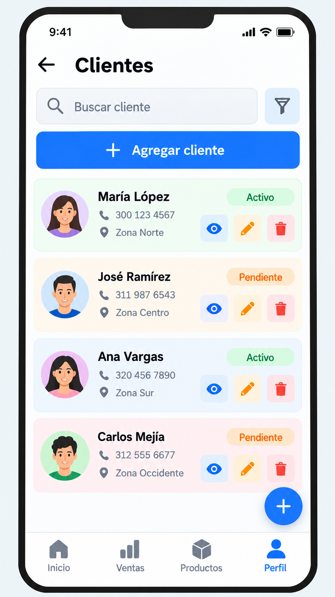
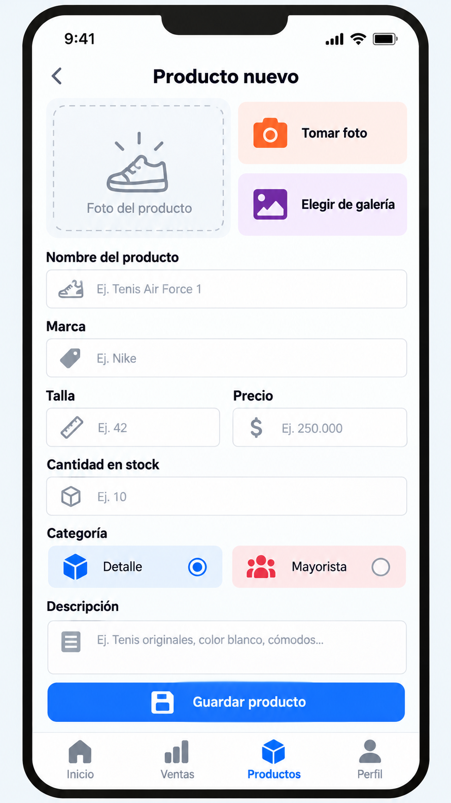
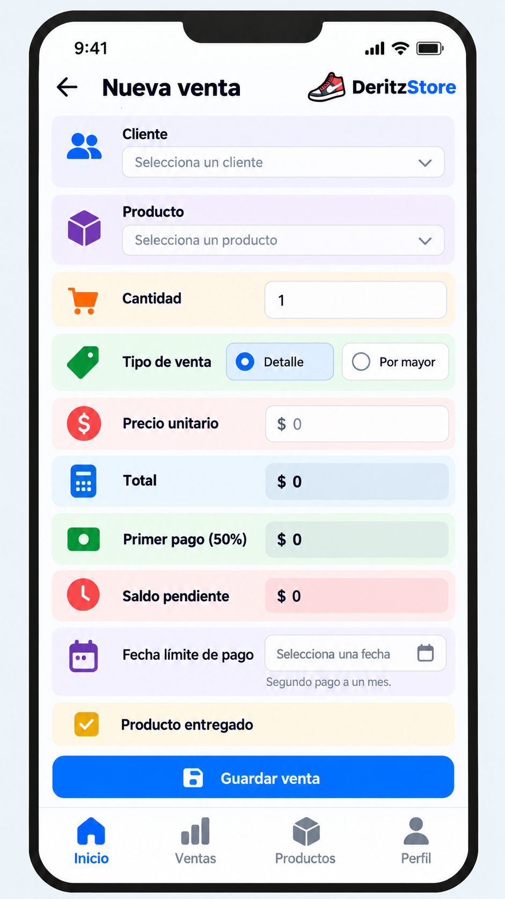
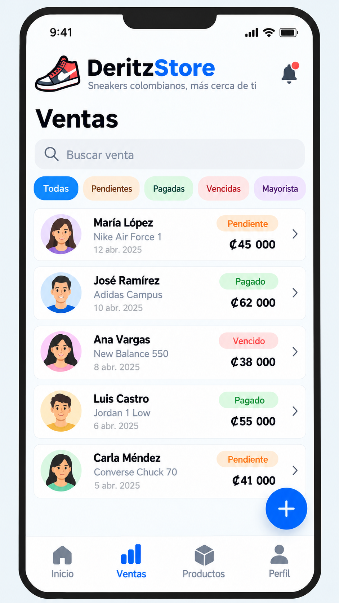
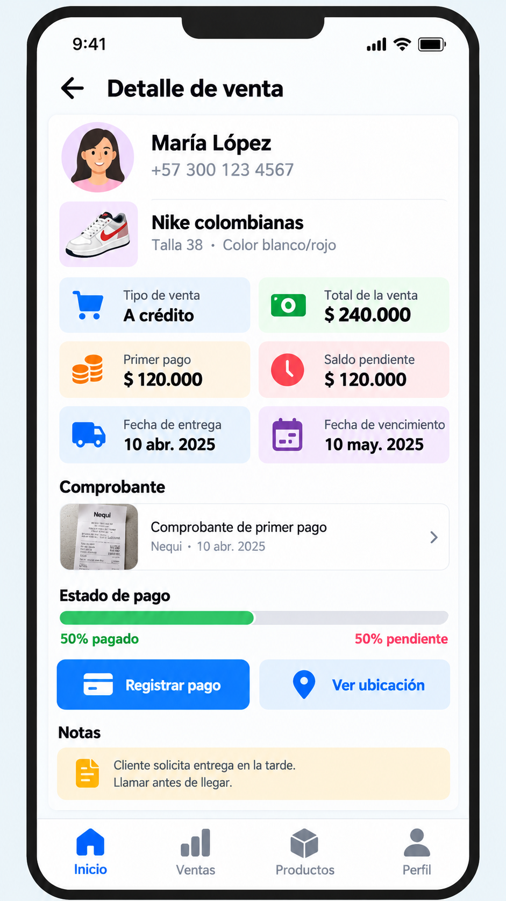
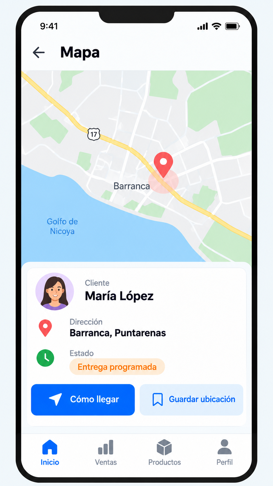
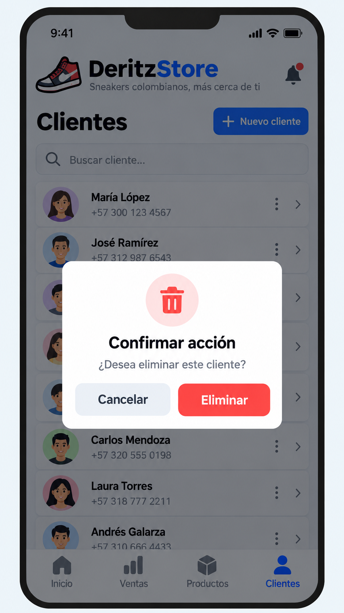

# DeritzStore

## Descripción del proyecto

DeritzStore es una aplicación móvil para gestionar las ventas de tenis colombianas.

La aplicación permitirá registrar clientes, productos y ventas, tanto al detalle como al por mayor.

En las ventas a crédito, el cliente podrá realizar un primer pago correspondiente al 50% del valor de la compra al momento de recibir el producto y cancelar el saldo restante un mes después.

La aplicación permitirá llevar un control de los pagos pendientes, ventas canceladas, clientes, productos y fechas de vencimiento.

## Funcionalidades principales

- Registro, edición, consulta y eliminación de clientes.
- Registro, edición, consulta y eliminación de productos.
- Registro de ventas al detalle.
- Registro de ventas al por mayor.
- Control de pagos en dos cuotas.
- Lista de ventas con filtros personalizados.
- Acceso a cámara o galería para agregar fotografías de productos o comprobantes.
- Uso de diálogos de confirmación.
- Registro y visualización de ubicaciones mediante mapa.

## Integrante

- Sharon Jacamo

## Mockups de la aplicación

A continuación se presentan los diseños preliminares de las principales pantallas de DeritzStore. Estos mockups representan la idea inicial de la interfaz y podrán ser modificados durante el desarrollo de la aplicación.

### 1. Pantalla de inicio

Esta pantalla presenta un resumen general de las ventas, pagos y pedidos registrados en DeritzStore.

### 2. Gestión de clientes

Permite visualizar los clientes registrados, buscarlos y realizar las operaciones de consultar, editar y eliminar.

### 3. Registro de productos y acceso a cámara o galería

Permite registrar un nuevo producto y agregar una fotografía utilizando la cámara del dispositivo o seleccionando una imagen desde la galería.

### 4. Registro de una nueva venta

Permite seleccionar el cliente y el producto, definir si la venta es al detalle o al por mayor y llevar el control del primer pago y del saldo pendiente.

### 5. Lista de ventas con filtros personalizados

Permite consultar las ventas registradas y filtrarlas por estado, como pendientes, pagadas, vencidas o ventas al por mayor.

### 6. Detalle de una venta

Muestra la información completa de una venta, incluyendo cliente, producto, monto total, primer pago, saldo pendiente y fecha de vencimiento.

### 7. Ubicación mediante mapa

Permite visualizar la ubicación del cliente o lugar de entrega de un pedido.

### 8. Dialog de confirmación

Se utilizarán cuadros de diálogo para confirmar acciones importantes, por ejemplo antes de eliminar un cliente.

## Avance de prueba

Se realiza este cambio desde la rama prueba01 para comprobar el flujo de trabajo mediante Pull Request.
